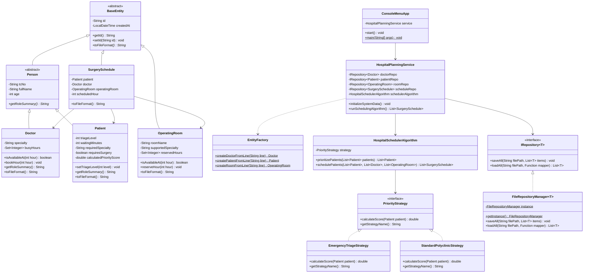

#  Hastane Planlama ve Çizelgeleme Sistemi (Hospital Planning System)

Bu proje, **Nesneye Yönelik Programlama (OOP)** dersi kapsamında; acil ve poliklinik hastalarının dinamik olarak önceliklendirilmesi, doktor çalışma saatleri ve ameliyathane uygunluklarının çakışmasız olarak çizelgelenmesi amacıyla geliştirilmiş konsol tabanlı bir Java uygulamasıdır.

---

##  Karşılanan Ödev Kriterleri ve Mimari Yapı

### 1. Nesneye Yönelik Programlama (OOP) İlkeleri
* **Kalıtım (Inheritance):** `BaseEntity` -> `Person` -> `Doctor` ve `Patient` şeklinde çok katmanlı kalıtım hiyerarşisi kurulmuştur.
* **Soyutlama (Abstraction):** `BaseEntity` ve `Person` sınıfları `abstract` olarak tasarlanmış; `toFileFormat()` ve `getRoleSummary()` soyut metotları alt sınıflarda zorunlu kılınmıştır.
* **Çok Biçimlilik (Polymorphism):** `PriorityStrategy` arayüzü üzerinden farklı puanlama stratejilerinin çalışma zamanında değiştirilmesi ve `Person` referansı üzerinden tüm hastane personelinin/hastalarının listelenmesi sağlanmıştır.
* **Kapsülleme (Encapsulation):** Tüm model alanları `private` tanımlanmış; TC Kimlik No, yaş, çalışma saatleri (08:00-17:00) ve Triyaj Seviyesi (1-5) kuralları `setter` metotları içinde doğrulamalarla (`IllegalArgumentException`) korunmuştur.

### 2. Uygulanan SOLID Prensipleri (5/5)
1. **Single Responsibility (Tek Sorumluluk):** Veri modelleri (`model`), dosya işlemleri (`FileRepositoryManager`), algoritmalar (`HospitalSchedulerAlgorithm`) ve iş kuralları (`HospitalPlanningService`) tamamen ayrı sınıflara bölünmüştür.
2. **Open/Closed (Açık/Kapalı):** Yeni bir hasta önceliklendirme kuralı eklemek için mevcut algoritma kodları değiştirilmez; `PriorityStrategy` arayüzünü uygulayan yeni bir sınıf eklenmesi yeterlidir.
3. **Liskov Substitution (Liskov Yerine Geçme):** `Person` üst sınıfı beklenen her yerde `Doctor` ve `Patient` alt sınıfları davranış bozukluğu olmadan kullanılabilmektedir.
4. **Interface Segregation (Arayüz Ayrımı):** Veri erişim işlemleri `IRepository<T>`, strateji işlemleri `PriorityStrategy` arayüzleriyle ayrıştırılmıştır.
5. **Dependency Inversion (Bağımlılığın Tersine Çevrilmesi):** `HospitalPlanningService` sınıfı somut dosya kayıt sınıfına değil, soyut `IRepository<T>` arayüzüne bağımlıdır (Constructor Injection).

### 3. Kullanılan Tasarım Kalıpları (Design Patterns)
1. **Strategy Pattern:** `PriorityStrategy` arayüzü ve bunu uygulayan `EmergencyTriageStrategy` ile `StandardPolyclinicStrategy` sınıfları sayesinde hasta öncelik puanı hesaplama algoritması çalışma zamanında dinamik olarak değiştirilebilmektedir.
2. **Singleton Pattern:** `FileRepositoryManager` sınıfı uygulama boyunca tek bir örnek (`getInstance()`) üzerinden çalışarak dosya okuma/yazma çakışmalarını önler.
3. **Factory Pattern:** `EntityFactory` sınıfı, `.txt` dosyalarından okunan ham metin satırlarını ilgili `Doctor`, `Patient` ve `OperatingRoom` nesnelerine dönüştürür.

### 4. Algoritmalar
* **Dinamik Triyaj Önceliklendirme (Max-Heap / PriorityQueue):** Hastaların aciliyet kodu, bekleme süresi (Starvation/Açlık önleme), yaş riski ve cerrahi müdahale gereksinimine göre ağırlıklı puan hesaplanır ve $O(N \log N)$ karmaşıklıkta sıralanır.
* **Greedy Zaman Çizelgeleme (Interval Scheduling):** Öncelik kuyruğundan çıkan hastalar için 08:00 - 17:00 mesai saatleri arasında hem branşı uygun doktorun hem de ameliyathanenin aynı anda müsait olduğu en erken saat dilimi açgözlü (greedy) yaklaşımla çakışmasız olarak atanır.

---

##  UML Sınıf Diyagramı



---

##  Kurulum ve Çalıştırma

1. Projeyi klonlayın:
   ```bash
   git clone [https://github.com/KULLANICI_ADINIZ/HospitalPlanningSystem.git](https://github.com/KULLANICI_ADINIZ/HospitalPlanningSystem.git)
   ```
2. IntelliJ IDEA ile projeyi Maven projesi olarak açın.
3. Uygulamayı başlatmak için `src/main/java/com/hospital/ui/ConsoleMenuApp.java` sınıfını çalıştırın.
4. 8 Birim testini çalıştırmak için `src/test/java/com/hospital/HospitalPlanningSystemTest.java` sınıfına sağ tıklayıp **Run** seçeneğine basın veya terminalden `mvn test` komutunu çalıştırın.